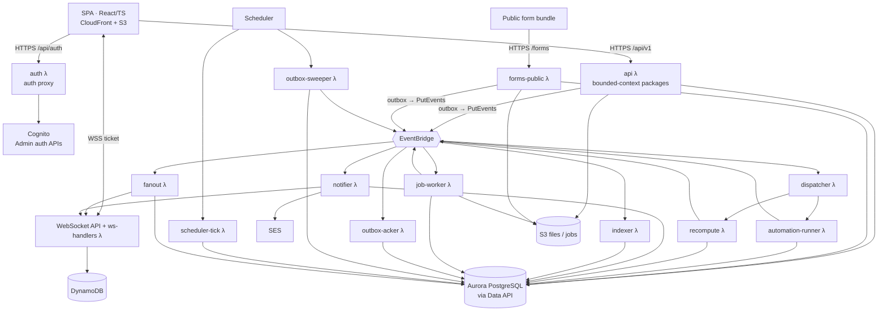

# 01 — System Context & Containers

## 1.1 System context (C4 level 1)
```mermaid
flowchart LR
  user([Org users<br/>Admin · Member · Viewer])
  prospect([Prospect<br/>anonymous])
  mailrecip([Email recipients<br/>P2 CRM email])
  subgraph TL[Tasklane — AWS account of the organization]
    sys[Tasklane<br/>boards · CRM · automations · dashboards]
  end
  idp[(Google SSO<br/>P2)]
  user -- HTTPS / WSS --> sys
  prospect -- HTTPS public forms --> sys
  sys -- notification & invite email (SES) --> user
  sys -. CRM email via SES, P2 .-> mailrecip
  mailrecip -. replies to reply.domain, P2 .-> sys
  user -. federated sign-in .-> idp
```

## 1.2 Containers (C4 level 2)
The authoritative list of deployable components, queues and triggers is **02 §2.7**; this view groups them.


## 1.3 Bounded contexts (Python packages, see `11-repo-structure.md`)
| Context (Python package) | Owns (tables) | HTTP routes (in `api` λ) | Consumes events |
|---|---|---|---|
| **workmgmt** | workspaces, boards, groups, columns, items, item_links, views | /workspaces /boards /items /views … | — |
| **computed** | computed values inside items, dependency graph | (internal) | item/column/link changes |
| **collab** | updates, likes, subscriptions, notifications, files, presence | /updates /files /notifications … | assignment/mention/automation-notify events |
| **automation** | automations, automation_runs, run_steps, schedules | /automations … | all item/status/group/activity events |
| **insights** | dashboards, widgets, search_documents | /dashboards /search /exports … | item/board changes (indexer) |
| **crm** | CRM template, timeline projection rules | /templates /timeline /activities | activity item events |
| **identity** | users, roles, workspace_members, board_members, permission sets, audit | /account /users … (auth flows: `auth` λ) | user/role changes |
| **forms** | forms (a view type) & submissions throttle | /forms (forms-public λ) | — |
| **platform** | outbox, jobs, rate limits, idempotency keys | — | — |

Rule: a context writes only its own tables; cross-context reads go through the owning package's query functions (enforced by import-linter in CI).

## 1.4 Main request flows
1. **Cell edit** — SPA `PATCH /items/{id}/values` → `api` λ: authorize from cached snapshot (epoch verified by the same statement) → **one SQL statement** (writable CTE): update value + version, activity log, board_changes, outbox → `PutEvents` → 200 with new version. Ack/sweeper guarantee delivery (05 §5.1). Consumers: realtime fan-out, automations, recompute (mirrors/formulas depending on it), indexer, notifier (People column).
2. **Automation** — event → EventBridge → SQS `dispatch-in` → dispatcher → SQS FIFO (group `auto:{automationId}:{itemId}`) → runner loads run state, evaluates conditions on current item, executes next unapplied step through the same domain services as the API (as the owner), records step result, emits events.
3. **Real-time** — event → SQS realtime → fanout λ: channel connections from DynamoDB → stale-epoch re-authorization in one SQL → row/computed visibility in one SQL per event → shape payload (D-018/D-020) → `PostToConnection`.
4. **Public form** — CloudFront → WAF (managed rules; challenge-token label → header) → forms-public λ: origin header, token, honeypot, per-viewer-IP counters and challenge requirement (07 §7.4), `submission_id` idempotency → create item via workmgmt service as actor "Form: <title>".
