# 02 — Deployment

## 2.1 Deployment diagram (one stage; identical topology in dev / staging / prod)

```mermaid
flowchart TB
  internet((Internet))
  subgraph Edge["Global edge"]
    R53[Route 53<br/>app · files · ws · reply]
    CF1[CloudFront app.domain<br/>S3 SPA · /api/* · /forms/*<br/>adds x-tl-origin secret header]
    CF2[CloudFront files.domain<br/>signed GET to S3 files]
    WAF[WAF web ACL on CF1<br/>managed rules · rate rules<br/>challenge token label → x-tl-chal]
  end
  subgraph Region["AWS Region (default us-east-1)"]
    S3W[(S3 web bucket · OAC)]
    COG[Cognito User Pool<br/>MFA ON TOTP · Admin auth flows only]
    HTTP[API GW HTTP API<br/>custom domain origin · execute-api endpoint DISABLED<br/>JWT authorizer except /auth/* and /forms/*]
    WSAPI[API GW WebSocket API<br/>$connect ticket authorizer]
    subgraph Fn["Lambda arm64 · Python 3.13 · Powertools · no VPC"]
      API[api λ<br/>all bounded contexts]
      AUTH[auth λ<br/>auth proxy]
      FRM[forms-public λ]
      WSH[ws-handlers λ<br/>connect · disconnect · message]
      DSP[dispatcher λ<br/>automations + recompute]
      RUN[automation-runner λ]
      CMP[recompute λ]
      FAN[fanout λ]
      NTF[notifier λ]
      IDX[indexer λ]
      JOB[job-worker λ]
      ACK[outbox-acker λ]
      SWP[outbox-sweeper λ]
      TCK[scheduler-tick λ]
    end
    EB{{EventBridge bus tasklane}}
    subgraph Q["SQS (each with DLQ)"]
      QRT[[realtime]]
      QDI[[dispatch-in]]
      QAU[[automations.fifo]]
      QCO[[recompute.fifo]]
      QNT[[notifications]]
      QNE[[notification-email · delayed]]
      QIX[[search-index]]
      QJB[[jobs]]
      QAK[[outbox-ack]]
    end
    SCH[EventBridge Scheduler<br/>1 min: sweeper · tick]
    subgraph Data["Data (KMS CMKs)"]
      AUR[(Aurora PostgreSQL 16 Serverless v2<br/>writer · Data API · PITR 35 d<br/>private subnets, no NAT)]
      DDB[(DynamoDB<br/>connections · presence · counters · tickets)]
      S3F[(S3 files · versioned)]
      S3J[(S3 jobs · 7 d)]
      S3B[(S3 auth assets<br/>breached-password bloom)]
      SM[Secrets Manager<br/>DB creds · origin secret]
    end
    SES[SES · DKIM/SPF/DMARC]
    OBS[CloudWatch · X-Ray · Synthetics · Budgets · CloudTrail]
  end
  internet --> R53 --> CF1 & CF2
  CF1 --- WAF
  CF1 --> S3W
  CF1 -->|/api/* /forms/*| HTTP
  CF2 --> S3F
  internet -->|wss + ticket| WSAPI
  HTTP --> API & FRM & AUTH
  AUTH -->|Admin* auth APIs| COG
  AUTH --> S3B
  WSAPI --> WSH --> DDB
  API & FRM & DSP & RUN & CMP & NTF & IDX & JOB & ACK & SWP & TCK & FAN -->|RDS Data API| AUR
  API & FRM & RUN & CMP & JOB & SWP -->|PutEvents| EB
  EB --> QRT & QDI & QNT & QIX & QJB & QAK
  QRT --> FAN -->|PostToConnection| WSAPI
  QDI --> DSP --> QAU & QCO
  QAU --> RUN
  QCO --> CMP
  QNT --> NTF -->|direct push user channel| WSAPI
  NTF --> QNE --> NTF
  NTF --> SES
  QIX --> IDX
  QJB --> JOB --> S3J
  QAK --> ACK
  SCH --> SWP & TCK
  TCK --> QAU & QJB
  API & FRM & JOB --> S3F
  API --> DDB
  FRM --> DDB
```

## 2.2 Why no VPC for Lambdas
Lambdas talk to Aurora only through the RDS Data API (HTTPS, IAM + Secrets Manager), to DynamoDB/S3/SQS/EventBridge/SES through public AWS endpoints. This removes NAT gateways (~US$33/mo each), ENI cold-start penalties and RDS Proxy minimums (ADR-002). Aurora sits in private subnets of a minimal VPC with no internet route.

## 2.3 Stages & accounts
| Stage | AWS account | Aurora capacity | Notes |
|---|---|---|---|
| dev | `tasklane-dev` | 0–4 ACU, auto-pause after 30 min | per-developer preview stacks share the dev cluster (separate schemas) — P2 |
| staging | `tasklane-staging` | 0.5–8 ACU, no auto-pause | north-star e2e + load tests run here |
| prod | `tasklane-prod` | writer 0.5–16 ACU with **scheduled minimum 2 ACU on business hours** (Scheduler → `ModifyDBCluster`, OPS-12/PERF-17; also enables Performance Insights); **no reader by default** (Data API is writer-only; a promotion-tier-0 reader that tracks writer capacity costs ≈ +$75/mo, config switch, OPS-13) | deletion protection, PITR 35 d, daily AWS Backup copy to a second region with multi-region KMS key |
Single-account deployment is supported by config (`stages` share one account with name prefixes) for a smaller org.

## 2.4 Sizing (prod, at D-007 scale)
| Resource | Setting |
|---|---|
| API Lambdas | **3 functions** (`api`, `auth`, `forms-public`) instead of one per context (AR-25): bounded contexts stay separate Python packages; 1,024 MB, timeout 29 s. Cold-start strategy chosen in Milestone 0 by measurement: plain slim package first; then **either** SnapStart **or** provisioned concurrency (they are mutually exclusive) on `api` only |
| Workers | 512–1,024 MB, SQS batch 10, concurrency limited with event-source `MaximumConcurrency` (not reserved concurrency, AR-31): fanout 10, dispatcher 5, runner 25 (≈ 50 runs/s), recompute 10, notifier 5, indexer 5, jobs 5 |
| Reserved concurrency | none by default (account quota hygiene); bootstrap runbook requests concurrency quota ≥ 1,000 |
| HTTP API throttling | 1,000 rps burst / 500 rps steady per stage; per-user limits in app (M1.3) |
| WebSocket | ≤ 500 connections; idle timeout 10 min, client heartbeat 30 s (also presence) |
| DynamoDB | on-demand; TTL on connections (2 h) and presence (90 s) and counters |
| S3 files | Intelligent-Tiering after 30 d; noncurrent versions expire 30 d; trash purge deletes objects |

## 2.5 DNS & edge
- `app.<domain>` → CloudFront (SPA + `/api/*` + `/forms/*` behaviors → HTTP API **custom-domain** origin; default `execute-api` endpoint disabled; CloudFront adds `x-tl-origin` secret header checked by middleware; origin request policy `AllViewerExceptHostHeader`, no caching on `/api/*`) — same origin avoids CORS (AR-6).
- `files.<domain>` → separate CloudFront distribution for signed file downloads (no app cookies, AR-30).
- `ws.<domain>` → WebSocket API custom domain (regional).
- `forms.<domain>` → CloudFront behavior serving the public form SPA bundle (separate small bundle, no auth code).
- `reply.<domain>` MX → SES inbound (P2, L11).

## 2.6 Deployment pipeline
GitHub Actions with OIDC role per account → `cdk deploy Network Data Identity Messaging` → **migration step** (pipeline job invoking the `migrate` Lambda asynchronously and polling its job row; not a CloudFormation custom resource, AR-32) → `cdk deploy Api Realtime Workers Edge Observability`. Migrations: forward-only SQL; expand in release N, contract only in release N+1; long DDL (`create index concurrently`) runs outside transactions via psql-equivalent statements split under the 45 s Data API limit or via a one-off CodeBuild task using psycopg; every migration is rehearsed on a staging restore of a prod snapshot. Promotion: main → dev (auto) → staging (auto + e2e + load gates) → prod (manual approval).

## 2.7 Authoritative component & queue inventory (AR-23)
| Component | Trigger | Concurrency | DLQ | Writes to (DB role) | Notes |
|---|---|---|---|---|---|
| `api` λ | HTTP API (`/api/v1/*`) | on demand | — | Aurora (`api_rw`), EventBridge, DynamoDB (counters, tickets), S3 (presign) | all bounded contexts |
| `auth` λ | HTTP API (`/api/auth/*`) | on demand | — | Cognito (Admin* scoped to pool), DynamoDB (counters), Aurora (users only), S3 (bloom filter) | auth proxy (SEC-11) |
| `forms-public` λ | HTTP API `/forms/*` | on demand | — | Aurora, EventBridge, DynamoDB | no JWT |
| `ws-handlers` λ | WebSocket $connect/$disconnect/$default | on demand | — | DynamoDB, EventBridge (presence) | ticket authorizer on $connect |
| `dispatcher` λ | SQS `dispatch-in` (EB rule: item/board/link/activity/button/computed events) | 5 | yes | SQS `automations.fifo`, `recompute.fifo`, Aurora (runs, recompute_pending) | the single dispatcher for **both** automations and recompute (no separate "recompute-dispatcher"); dynamic MessageGroupId |
| `automation-runner` λ | SQS `automations.fifo` | 25 | yes | Aurora, EventBridge | G1 |
| `recompute` λ | SQS `recompute.fifo` | 10 | yes | Aurora, EventBridge | ADR-009 |
| `fanout` λ | SQS `realtime` (EB rule: all UI-relevant events) | 25 | yes | WebSocket API, DynamoDB; **reads Aurora** (`reader`) for channel/row/computed visibility | D-018/D-020 shaping |
| `notifier` λ | SQS `notifications`, `notification-email` (delayed 300 s) | 5 | yes | Aurora, WebSocket API, SES | per-recipient rendering |
| `indexer` λ | SQS `search-index` | 5 | yes | Aurora | search_documents |
| `job-worker` λ | SQS `jobs` | 5 | yes | Aurora, S3 jobs/files, EventBridge | import/export/bulk/template/purge/nightly recompute batches |
| `outbox-acker` λ | SQS `outbox-ack` (EB rule: all events) | 2 | yes | Aurora | marks published |
| `outbox-sweeper` λ | Scheduler 1 min | 1 | — | EventBridge, Aurora | republish unacked > 30 s |
| `scheduler-tick` λ | Scheduler 1 min | 1 | — | SQS `automations.fifo`, `jobs`, WebSocket (presence sweep) | T4, nightly, purge, partitions |
| `migrate` λ | pipeline invoke | 1 | — | Aurora | forward-only migrations |
| Cognito | — | — | — | — | no triggers needed except custom message (invite email text) |

## 2.8 Delivery contract (OPS-2, OPS-4) — enforced by CDK assertions
| Queue | Type | Consumer | Batch / window | Partial batch response | Visibility timeout | maxReceiveCount | DLQ retention | DLQ policy (runbook) |
|---|---|---|---|---|---|---|---|---|
| realtime | std | fanout | 10 / 100 ms | yes | 6 × 30 s | 3 | 1 h | discard (stale) |
| dispatch-in | std | dispatcher | 10 / 0 | yes | 6 × 30 s | 5 | 14 d | redrive after fix |
| automations.fifo | FIFO | automation-runner | 10 / 0 | yes, stop at first failure in a group and return the rest | 6 × 60 s | 4 | 14 d | redrive via `StartMessageMoveTask`; runs re-validated |
| recompute.fifo | FIFO | recompute | 10 / 0 | yes (as above) | 6 × 60 s | 5 | 14 d | discard; drift checker repairs |
| notifications | std | notifier | 10 / 0 | yes | 6 × 30 s | 5 | 14 d | redrive |
| notification-email | std (delayed) | notifier | 10 / 0 | yes | 6 × 30 s | 5 | 14 d | redrive |
| search-index | std | indexer | 10 / 1 s | yes | 6 × 30 s | 5 | 14 d | discard; `ops/replay --consumer indexer` |
| jobs | std | job-worker | 1 | — | 6 × 900 s | 3 | 14 d | inspect, resume job |
| outbox-ack | std | outbox-acker | 100 / 1 s | yes | 6 × 30 s | 5 | 14 d | discard (sweeper covers) |
- Every **EventBridge rule target** and every **Scheduler target** has a `RetryPolicy` (max age 1 h, 20 attempts) and its own DLQ. Alarms: `FailedInvocations`, `InvocationsFailedToBeSentToDlq`, `EventsDropped`.
- KMS key policies grant `events.amazonaws.com` and `scheduler.amazonaws.com` `kms:GenerateDataKey`/`Decrypt` on queue keys (CDK assertion).
- Consumers are **tolerant readers** of event `schema_version` N and N-1 (OPS-8).

## 2.9 Deploy safety (OPS-8, OPS-9)
- Every function is published with a `live` alias; **CodeDeploy `Canary10Percent5Minutes`** for `api` and workers, automatic rollback on 5xx, error-rate, DLQ-depth or canary alarms.
- Deploy order: consumers (Workers, Realtime) **before** producers (Api); contract test replays the previous release's event fixtures against new consumers.
- Data stack: `RemovalPolicy.RETAIN`, termination protection, pipeline gate fails if the change set contains `Replace`/`Delete` on Aurora, DynamoDB, S3, Cognito, KMS.
- Migrations: every DDL runs with `SET lock_timeout = '3s'` (retry ×5 with backoff) and `statement_timeout`; migration linter (`squawk`) bans non-concurrent index builds and table rewrites on `items`, `item_links`, `activity_log`; manual Aurora snapshot before each prod migration.
- Aurora endpoint ARN and secret ARN are read from **SSM parameters** (not hard-wired), so a PITR restore = swap parameters + redeploy (OPS-10).
