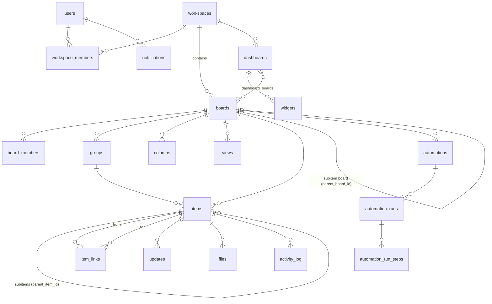

# 03 — Data Model (Aurora PostgreSQL 18.6, D-026)

## 3.1 Principles
- One schema `tl`; all IDs `bigint` from a single sequence (`tl.id_seq`) so item IDs are globally unique (B6.3); ids are **not** creation-ordered (sequence caching, PERF-19) — creation order is `(created_at, id)`.
- Board-defined columns are **metadata rows**; item cell values live in one `jsonb` document per item keyed by column id. This gives dynamic schemas without DDL, and Postgres can still filter, sort and aggregate on them (ADR-001).
- Relations (Connect columns) are **rows** in `item_links`, not JSON, so reflections, reverse lookups, mirrors and row-level visibility are joins.
- Computed values (Formula, Mirror, C38) are materialized in a separate `computed jsonb` per item (ADR-009) so writes of user values never race with recompute.
- Soft state: `state ∈ {active, archived, deleted}` + `deleted_at`; purge job hard-deletes after 30 days (A11).
- Every mutation writes the change, its `activity_log` row, its `board_changes` row and its `outbox` row **in one SQL statement** (writable CTE) — one Data API round trip, no explicit transaction on hot paths (AR-3). Multi-statement transactions are reserved for cold paths (template apply, column conversion, imports, moves).
- Ordering: fractional-index text keys (`position text COLLATE "C"`) for groups, items, views, widgets, so a move updates one row.

## 3.2 Entity-relationship overview


## 3.3 Core tables (abridged DDL; full DDL lives in `backend/migrations`)
```sql
create table tl.account (id smallint primary key default 1 check (id = 1),
  name text not null, logo_file_id bigint, timezone text not null default 'UTC',
  date_format text not null, week_start smallint not null, allowed_domains jsonb not null default '[]',  -- jsonb: Data API has no array params
  require_mfa boolean not null default true, perm_epoch bigint not null default 0,  -- global permission epoch (07 §7.2)
  db_generation bigint not null default 1,   -- bumped by the restore runbook (OPS-10)
  settings jsonb not null default '{}');

create table tl.users (id bigint primary key, cognito_sub uuid unique, email citext unique not null,
  name text not null, title text, phone text, photo_file_id bigint, timezone text,
  role text not null check (role in ('admin','member','viewer','guest')),
  status text not null check (status in ('invited','active','deactivated')),
  tokens_valid_after timestamptz not null default 'epoch',   -- AR-9 revocation
  created_at timestamptz not null default now(), updated_at timestamptz not null default now());

create table tl.workspaces (id bigint primary key, name text not null, description text, icon jsonb,
  kind text not null check (kind in ('open','closed')), is_default boolean not null default false,
  position text not null, state text not null default 'active', deleted_at timestamptz, version bigint not null default 1);
create table tl.workspace_members (workspace_id bigint references tl.workspaces, user_id bigint references tl.users,
  role text not null check (role in ('owner','member')), primary key (workspace_id, user_id));

create table tl.boards (id bigint primary key, workspace_id bigint not null references tl.workspaces,
  folder_id bigint, parent_board_id bigint references tl.boards,       -- set for subitem boards (B7)
  name text not null, description text, item_term text not null default 'Item',
  kind text not null check (kind in ('main','private','shareable')),
  permission_set text not null default 'edit_everything'
    check (permission_set in ('edit_everything','edit_content','edit_assigned','view_comment')),
  assign_column_id text,                                              -- for edit_assigned
  crm_entity_type text check (crm_entity_type in ('lead','contact','account','deal')),
  row_visibility text not null default 'board' check (row_visibility in ('board','related')),  -- 'related' = Activities (D-016)
  is_system boolean not null default false, top_group_id bigint, position text not null,
  state text not null default 'active', deleted_at timestamptz, version bigint not null default 1,
  created_by bigint, created_at timestamptz not null default now());
create table tl.board_members (board_id bigint references tl.boards, principal_type text not null default 'user',
  principal_id bigint not null, role text not null check (role in ('owner','member')),
  subscribed boolean not null default true, primary key (board_id, principal_type, principal_id));

create table tl.groups (id bigint primary key, board_id bigint not null references tl.boards,
  title text not null, color text not null, position text not null,
  state text not null default 'active', deleted_at timestamptz);

create table tl.columns (board_id bigint references tl.boards, id text not null,  -- slug, immutable
  title text not null, type text not null, description text, settings jsonb not null default '{}',
  position text not null, state text not null default 'active', deleted_at timestamptz,
  version bigint not null default 1, primary key (board_id, id));
create unique index on tl.columns (board_id, lower(title)) where state = 'active';

create table tl.items (id bigint primary key, board_id bigint not null references tl.boards,
  group_id bigint not null references tl.groups, parent_item_id bigint references tl.items,
  name text not null, position text not null,
  values jsonb not null default '{}',         -- user-entered cell values, keyed by column id
  computed jsonb not null default '{}',       -- materialized formula / mirror / timeline-column values (full set)
  version bigint not null default 1,          -- user-data version, monotonically increasing per item (D-010)
  computed_version bigint not null default 0, -- separate counter for computed updates (AR-2)
  computed_source_seq bigint not null default 0, -- highest board_changes.seq covered by computed (OPS-1)
  created_idem_key text unique,               -- automation step / idempotency key that created it (AR-13)
  state text not null default 'active', deleted_at timestamptz, archived_at timestamptz,
  created_by_type text not null, created_by bigint, created_at timestamptz not null default now(),
  updated_by_type text, updated_by bigint, updated_at timestamptz not null default now());
create index items_board_list on tl.items (board_id, state, group_id, position);
create index items_parent on tl.items (parent_item_id) where parent_item_id is not null;
create index items_values_gin on tl.items using gin (board_id, values jsonb_path_ops);   -- btree_gin composite (PERF-11); kept: S-1 showed ≈10× on selective filters
-- TOAST lz4 via the Aurora parameter default_toast_compression (D-028), not per-column DDL (PERF-9)
alter table tl.items set (fillfactor = 90);   -- HOT updates for computed-only changes (PERF-11)
-- long text / rich values live out of the hot document (PERF-9):
create table tl.item_text (item_id bigint not null, column_id text not null, body text not null,
  primary key (item_id, column_id));         -- Long text values; values->col holds {"len": n, "preview": first 200 chars}

create table tl.item_links (board_id bigint not null, column_id text not null,
  from_item_id bigint not null references tl.items, to_item_id bigint not null references tl.items,
  to_board_id bigint not null,               -- maintained on item move; lets visibility skip joining items (PERF-20)
  position text not null, created_at timestamptz not null default now(),
  primary key (from_item_id, column_id, to_item_id));
create index item_links_reverse on tl.item_links (to_item_id, board_id, column_id);
create index item_links_vis on tl.item_links (from_item_id, column_id, to_board_id);
-- ONE row per link (AR-19). A reflected column on the other board stores no rows: it is read through
-- item_links_reverse, so "link + reflection in one transaction" (C18.1) holds by construction.
-- Single-item enforcement (C18.6) on either side uses replace semantics inside one statement:
--   delete existing links of the single-valued side, insert the new one; the statement locks both items
--   with `select ... for update` ordered by item id (deadlock-free); 40P01 retried once.

create table tl.views (id bigint primary key, board_id bigint not null references tl.boards,
  name text not null, type text not null check (type in ('table','kanban','form','calendar','gantt','chart','dashboard')),
  settings jsonb not null default '{}', filter jsonb, sort jsonb, group_by jsonb,
  position text not null, is_default boolean not null default false, version bigint not null default 1,
  public_token text unique);                   -- forms only, 128-bit random, url-safe
create table tl.view_item_positions (view_id bigint, item_id bigint, position text not null,
  primary key (view_id, item_id));            -- Kanban card order per view (D5.7)
```

## 3.3a Change log for gap sync (AR-18)
```sql
create table tl.board_changes (seq bigserial, board_id bigint not null, item_id bigint,
  kind text not null,              -- value, computed, links, moved, archived, deleted, restored, structure
  columns text[], xid xid8 not null default pg_current_xact_id(), at timestamptz not null default now(),
  primary key (seq, at)) partition by range (at);          -- daily partitions, dropped after 2 days (PERF-16)
create index on tl.board_changes (board_id, xid);
```
Written in the same statement as each mutation (and by recompute). **Transactional cursor on xid (PERF-4, FR-1)**: the cursor is an `xid8` watermark, not a seq. `POST /boards/{id}/changes {since_xmin}` returns rows with `xid >= :since_xmin and xid < pg_snapshot_xmin(pg_current_snapshot())` (every transaction below the current xmin has finished), and `next_since_xmin` = that current xmin. A change can therefore never be skipped regardless of how seq values interleave. Index `(board_id, xid)`. `seq` remains only a realtime gap hint. No count-based overlap. Retention: daily partitions, the partition older than 48 h is dropped; cursors older than 24 h get `410 resync` → full reload. Retained 24 h; older gaps → full reload. Responses carry `db_generation` (from `tl.account.db_generation`, incremented by the restore runbook); a client holding a different generation does a full reload (OPS-10).

## 3.4 Cell value encoding (`items.values`)
| Type | JSON value | Notes |
|---|---|---|
| text, name* | `"string"` | *name is stored in `items.name`, not in `values` |
| long_text | `{"len": n, "preview": "first 200 chars"}` | full body in `tl.item_text` (PERF-9) |
| numbers | `"1234.5"` (decimal string) | string keeps precision; cast `(values->>'c')::numeric` in queries |
| status | `{"l": 3}` | label id; labels in column settings |
| dropdown | `{"l": [1, 7]}` | |
| people | `{"p": [{"t":"u","id":42}]}` | `t:"t"` reserved for teams (P2, rejected in P1) |
| date | `{"d":"2026-11-02"}` or `{"ts":"2026-11-02T14:00:00Z"}` | C8.1/C8.2 |
| timeline | `{"from":"2026-11-01","to":"2026-11-10"}` | |
| email / phone / link | `{"email":…,"text":…}` / `{"e164":…,"cc":"US"}` / `{"url":…,"text":…}` | |
| checkbox | `true` | absent = unchecked |
| files | `{"f":[file ids]}` | metadata in `tl.files` |
| connect, mirror, formula, subitems, item_id, creation_log, last_updated, button, C38 | — | not in `values` (links in `item_links`, computed in `computed`, logs from row metadata) |
Empty value = key absent. A per-type Python codec (`tasklane/schema/types/*.py`, shared kernel — 11) owns validate / normalize / display_text / sort_key / sql_filter / sql_aggregate / csv_parse / csv_format — one module per type, unit-tested against the contract table in requirements C40.6.

## 3.4a QuerySpec — the single filter/sort/group DSL (DX-5)
```json
{"filter": {"op": "and", "rules": [
    {"col": "deal_stage", "op": "any_of", "value": [3, 0]},
    {"col": "deal_owner", "op": "contains_person", "value": ["me"]},
    {"op": "or", "rules": [{"col": "deal_value", "op": "gt", "value": "10000"},
                           {"col": "$group", "op": "in", "value": ["topics"]}]}]},
 "sort": [{"col": "deal_value", "dir": "desc"}],
 "group_by": {"col": "deal_stage"},
 "search": "acme", "person": "me"}
```
- Pseudo-columns: `$group`, `$name`, `$created_at`, `$updated_at`. Tokens: `"me"`, date relatives `{"rel":"today|this_week|this_month|overdue|next_n_days","n":7}`.
- Operators are enums declared per column type by its codec; `GET /boards/{id}/schema` lists them per column so the client builds filter UIs from data.
- Validated by Pydantic `QuerySpec` (max 10 rules, depth 3). Used by: views (`views.filter/sort/group_by`), widgets, automation conditions (G3), kanban lanes, exports, dashboard filters.
- Golden corpus `contracts/queryspec/*.json` (spec + dataset → expected ordered ids) runs against the SQL compiler (and covers AC-D2-3, D2.7).

## 3.5 Concurrency (D-010) — single-statement writes (revised after PERF-1/2/3, SEC-3)
**CTE rules (ADR-002 appendix):** (1) the first CTE takes row locks with `SELECT … FOR UPDATE` and captures pre-images (PG16 `RETURNING` cannot see old values; under READ COMMITTED `FOR UPDATE` re-reads the latest committed row after waiting); (2) every other write CTE depends on the main write CTE `u` (data dependency defines execution); (3) no sibling CTE reads **rows written** by another sibling (reading the pre-image in the lock CTE is fine); (4) the permission guard is part of the `WHERE` clause (SEC-3); 0 rows ⇒ re-authorize and retry once.

- **Scalar cell write** (example: Status):
```sql
with old as (select id, values -> :col as v from tl.items
             where id = :id and state = 'active' for update),
     u as (update tl.items i set values = jsonb_set(i.values, array[:col], :v::jsonb, true),
                  version = i.version + 1, updated_by = :uid, updated_at = now()
           from old
           where i.id = old.id
             and (select perm_epoch from tl.account) = :cached_epoch                 -- SEC-3 guard
             and (:assign_col::text is null                                                       -- edit_assigned guard (B7.7)
                  or i.values -> :assign_col -> 'p' @> :me::jsonb
                  or exists (select 1 from tl.items p where p.id = i.parent_item_id
                             and p.values -> :assign_col -> 'p' @> :me::jsonb))
           returning i.id, i.board_id, i.version, old.v as before, i.values -> :col as after),
     a as (insert into tl.activity_log (board_id, item_id, actor_type, actor_id, kind, column_id, before, after)
           select board_id, id, :atype, :aid, 'value', :col, before, after from u),
     c as (insert into tl.board_changes (board_id, item_id, kind, columns) select board_id, id, 'value', array[:col] from u returning seq),
     r as (insert into tl.recompute_pending (item_id, requested_seq) select u.id, c.seq from u, c
           on conflict (item_id) do update set requested_seq = greatest(tl.recompute_pending.requested_seq, excluded.requested_seq)),
     o as (insert into tl.outbox (event_id, type, board_id, item_id, payload)
           select :eid, 'item.values_changed', board_id, id,
                  jsonb_build_object('changes', jsonb_build_array(jsonb_build_object('col', :col, 'old', before, 'new', after)),
                                     'version', version, 'seq', (select seq from c), 'mutation_id', :mid) from u)
select u.version, (select seq from c) from u
union all
select null, null where not exists (select 1 from u);   -- plus a reason probe: see note
```
  Ids inside People values are stored as **JSON numbers** (codec normalizes; `:me` = `[{"t":"u","id":42}]`). When `u` returns 0 rows, a cheap follow-up classification query (`case when not exists item then 'not_found' when epoch changed then 'stale_epoch' else 'forbidden' end`) maps the result to 404 / retry once / 403 (FR-9).
  (`array[:col]` is a SQL array *expression* built from a scalar parameter — allowed; array *parameters* are not.) Same-item formulas are evaluated **inline** in `u` from the compiled formula SQL over the new values (PERF-6), so the user's own formula columns update in the same response.
- **Multi-value delta** (people, dropdown, files) in SQL, order-preserving and empty-safe (PERF-1):
```sql
-- add: keep existing order, append new elements not yet present
values || jsonb_build_object(:col, jsonb_build_object('p',
   (select coalesce(jsonb_agg(e order by ord), '[]'::jsonb) from (
      select e, min(ord) ord from (
         select e, ord from jsonb_array_elements(coalesce(values -> :col -> 'p', '[]')) with ordinality as x(e, ord)
         union all
         select e, 1000000 + ord from jsonb_array_elements(:add::jsonb) with ordinality as y(e, ord)) z
      group by e) w)))
-- remove: drop the key entirely when the result is empty ("empty = key absent")
case when <remaining agg> is null then values - :col
     else values || jsonb_build_object(:col, jsonb_build_object('p', <remaining agg>)) end
```
  Golden tests: add to empty cell, re-add existing element, remove last element, order preserved, concurrent add/add (AC-B6-7).
- **Connect add/remove (PERF-3, C18.6)**: phase 1 CTE locks `{from item, added/removed targets, current counterparts on the single-valued side}` with `order by id for update` (deadlock-free); phase 2 writes `item_links` (single row per link) and, for **every item whose effective links changed** (from, to, and the replaced counterpart), bumps `version`, writes `board_changes` and outbox rows. Contract test replays AC-C18-3 through the client version rule.
- **Write references are authorized (SEC-1, SEC-2)**: every id in a write payload (link targets, activity Related items, file ids, people) is checked inside the statement against `VisibleItems(actor)` / file binding rules; any failure ⇒ 0 rows ⇒ 404 for the whole request (no per-id oracle).
- **Files (SEC-1)**: adding a file id to a cell/update requires `files.state = 'pending' and files.uploaded_by = actor` (or the file is already bound to the same item+column); the same statement binds `files.item_id/column_id/update_id` and sets `state='bound'`. Download authorization uses the file's **bound** item only.
- **Round-trip budget (PERF-17)**: hot paths ≤ 2 Data API calls on a warm permission cache (≤ 3 on a cold one: snapshot load first, then the guarded mutation). Board queries return rows + group summaries in **one** statement as JSON (≤ 1 MiB) or summaries are fetched by a separate cached call for boards > 20k items.
- **Bulk/cold paths (PERF-15)**: bulk updates lock targets with `select … order by id for update`; column conversions/deletes on large boards run as resumable chunked jobs (≈ 5k rows per statement) with a `converting` column state.

- **Structural objects** (columns, groups, views, automations, dashboards, widgets, boards): `update … where id=$id and version=$expected` → 0 rows ⇒ 409 with current version.

## 3.6 Collaboration, automation, insights tables (abridged)
```sql
create table tl.updates (id bigint primary key, item_id bigint not null, board_id bigint not null,
  parent_id bigint, author_id bigint not null, body jsonb not null, body_text text not null,
  pinned boolean not null default false, edited_at timestamptz, deleted_at timestamptz, created_at timestamptz not null default now());
create table tl.update_likes (update_id bigint, user_id bigint, primary key (update_id, user_id));
create table tl.item_subscriptions (item_id bigint, user_id bigint, primary key (item_id, user_id));
create table tl.notifications (id bigint primary key, user_id bigint not null, type text not null, item_id bigint,
  board_id bigint, actor jsonb, payload jsonb not null, group_key text, read_at timestamptz,
  created_at timestamptz not null default now());
create index on tl.notifications (user_id, created_at desc);
create table tl.files (id bigint primary key, s3_key text not null, name text not null, size bigint not null,
  mime text not null, sha256 text, uploaded_by bigint, board_id bigint, item_id bigint, column_id text,
  update_id bigint, state text not null default 'pending', created_at timestamptz not null default now());
-- notifications dedup (AR-28):
create unique index on tl.notifications (user_id, (payload->>'event_id'), type);

create table tl.activity_log (id bigint, board_id bigint not null, item_id bigint, actor_type text not null,
  actor_id bigint, kind text not null, column_id text, before jsonb, after jsonb, at timestamptz not null default now())
  partition by range (at);                       -- monthly partitions, dropped after 12 months (A15.4)
-- per partition: index (board_id, at desc), index (item_id, at desc)  (PERF-20)

create table tl.automations (id bigint primary key, board_id bigint not null, owner_id bigint not null,
  name text not null, trigger jsonb not null, conditions jsonb not null default '[]', actions jsonb not null,
  state text not null check (state in ('active','inactive','needs_attention')), version bigint not null default 1,
  created_at timestamptz not null default now());
create table tl.automation_runs (id bigint primary key, automation_id bigint not null, item_id bigint,
  event_id uuid not null, chain_id uuid not null, chain_depth smallint not null,
  status text not null check (status in ('queued','running','succeeded','failed','skipped','stopped')),
  error text, started_at timestamptz, finished_at timestamptz, unique (automation_id, event_id));   -- G1.7
create table tl.automation_run_steps (run_id bigint, step_no smallint, status text not null,
  output jsonb, error text, idem_key text unique, primary key (run_id, step_no));               -- G1.8

create table tl.dashboards (id bigint primary key, workspace_id bigint not null, name text not null,
  kind text not null check (kind in ('main','private')), settings jsonb not null default '{}', version bigint not null default 1,
  state text not null default 'active');
create table tl.dashboard_boards (dashboard_id bigint, board_id bigint, primary key (dashboard_id, board_id));
create table tl.dashboard_members (dashboard_id bigint, user_id bigint, role text, primary key (dashboard_id, user_id));
create table tl.widgets (id bigint primary key, dashboard_id bigint not null, type text not null,
  title text, layout jsonb not null, settings jsonb not null, state text not null default 'active', version bigint not null default 1);

create table tl.search_documents (entity_type text not null, entity_id bigint not null, board_id bigint,
  workspace_id bigint, title text not null, body text, tsv tsvector generated always as
  (setweight(to_tsvector('simple', coalesce(title,'')),'A') || setweight(to_tsvector('simple', coalesce(body,'')),'B')) stored,
  updated_at timestamptz not null, primary key (entity_type, entity_id));
create index on tl.search_documents using gin (tsv);
create index on tl.search_documents using gin (title gin_trgm_ops);
```

## 3.7 Platform tables
```sql
create table tl.recompute_pending (item_id bigint primary key, requested_seq bigint not null,
  requested_at timestamptz not null default now(), claimed_until timestamptz);

create table tl.leases (name text primary key, holder text, until timestamptz not null default 'epoch');   -- singleton jobs (FR-3)       -- dirty set for recompute (PERF-5, OPS-1)

create table tl.outbox (id bigserial, event_id uuid not null, type text not null,
  schema_version smallint not null default 1,                    -- OPS-8
  board_id bigint, item_id bigint, payload jsonb not null, created_at timestamptz not null default now(),
  published_at timestamptz, publish_attempts smallint not null default 0, last_published_at timestamptz,   -- OPS-5
  primary key (id, created_at), unique (event_id, created_at)) partition by range (created_at);   -- daily partitions, dropped after 7 days (PERF-16)
create index outbox_unpublished on tl.outbox (id) where published_at is null;
create table tl.idempotency_keys (key text not null, user_id bigint not null, request_hash text not null,
  status text not null default 'in_progress', response jsonb, created_at timestamptz not null default now(),
  primary key (user_id, key));   -- SEC-15: keys are per user; same key + different request_hash → 422
-- inserted 'in_progress' in the same statement as the create (on conflict → return stored / 409 if in progress); purged after 24 h (AR-28)
-- outbox rows with published_at older than 7 days are purged daily (AR-28)
create table tl.jobs (id bigint primary key, type text not null, status text not null, progress jsonb,
  input jsonb, result jsonb, created_by bigint, created_at timestamptz not null default now());
create table tl.audit_events (id bigint primary key, actor_id bigint, kind text not null, target jsonb,
  ip inet, user_agent text, at timestamptz not null default now());           -- P1 writes, K9 UI P2
```

## 3.8 DynamoDB (non-system-of-record, ephemeral)
| Table | PK / SK | Items | TTL |
|---|---|---|---|
| `connections` | `CONN#<connectionId>` / `META` and `CH#<channel>` | user id, perm_epoch at subscribe, channels; GSI1 `channel` → connectionIds | 2 h |
| `presence` | `BOARD#<id>` / `USER#<id>` | last heartbeat | 90 s |
| `counters` | `RL#<scope>#<key>#<window>` | rate-limit counters (forms per IP, sign-in failures per account+IP, presign slots) | window |

## 3.9 Size limits vs Data API (1 MiB per response, 64 KB per row, 45 s statement, writer-only)
- List queries project only needed columns of `values`/`computed` (`jsonb_build_object` over requested column ids) and truncate long text to 500 chars in list payloads; full values via item endpoint.
- Page size adaptive: default 200 items, max 500, and the query builder lowers the page size when the projected width × rows estimate exceeds 768 KiB.
- An item whose full JSON exceeds 64 KB (only possible with many long-text columns) is fetched column-by-column by the item endpoint (`values -> 'col'`) — covered by a dedicated test.
- **Rich text (AR-21)**: list endpoints for updates and timeline never select `body_text`; they project `left(body::text, 16000)` plus `body_truncated` flag; full body via `GET /updates/{id}` which returns body as separate column chunks of ≤ 48 KB when needed. Bodies whose JSON exceeds 256 KB are rejected (E3.1's 50,000 chars fit well below that).
- **Activity log**: before/after for long text stored truncated to 1,000 chars + sha256 of full value.
- **Arrays (AR-4, PERF-18)**: no array parameters and no `= any(:param)`; sets are passed as JSON text and used as `in (select … from jsonb_array_elements_text(:p::jsonb))` or as containment `@> :p::jsonb`. The strict fake rejects both array params and `any(:param)` patterns.
- **Writer-only (AR-5)**: all queries hit the writer; scaling is vertical (max ACU) — read replicas do not offload Data API traffic.
