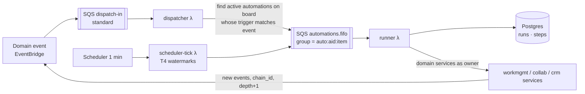

# 06 — Automation Engine (ADR-006)

## 6.1 Model
An automation is stored as data (`tl.automations`): `trigger` (type + params), `conditions[]`, `actions[]` (each with type, params, field mappings, variable templates). The catalog (G6) is a static, versioned registry in code: each trigger/condition/action type declares its parameter schema (JSON Schema), sentence template, applicable column types, and an implementation class. Recipes in the catalog are prefilled automation documents. The 14 seeded CRM automations are produced from catalog recipes by the CRM template (AC-G6-1).



## 6.2 Dispatcher
- Loads the board's active automations, cached per board keyed by `boards.automation_version` (incremented on any automation create/update/state change). Every event payload carries the board's current `automation_version`, so the dispatcher detects a stale cache without a query and reloads (AR-12) — a just-created automation is never missed.
- Trigger matching is a pure function `matches(trigger, event) -> bool` per trigger type (unit-tested per T1–T7). T3 supports label sets; T2 excludes computed columns; T7 emits one match per related item's board (L10.5).
- Skips: archived/trashed items, imports without opt-in, events whose `chain_depth ≥ 5` (marks a `stopped: loop limit` run), events where the same automation already ran in this `chain_id` for this item (G1.6).
- Creates the `automation_runs` row (`insert … on conflict (automation_id, event_id) do update set automation_id = excluded.automation_id returning id, status` → duplicate deliveries collapse, G1.7); if the returned run is still `queued` it is (re)sent — FIFO group `auto:{automation_id}:{item_id}` (G1.13), dedup id = run id, so re-sending is safe (OPS-3). A reaper in the jobs schedule re-enqueues runs `queued`/`running` for > 5 min (respecting `attempts`); alarm on stuck-run age.

## 6.3 Runner
```
load run, automation (version pinned at dispatch), item (current state)
validate references (G1.15) → needs_attention + notify, stop
evaluate conditions on current state (G1.5) → skipped if false
resolve owner permissions; fail if owner lacks rights (AC-G1-3, AC-G5-1)
for step n in actions, starting at first step without status=done:     # G1.8 resume
    idem_key = f"{event_id}:{automation_id}:{n}"
    if step row with idem_key exists and done: continue
    ctx = VariableContext(item, trigger payload, step outputs[1..n-1], owner visibility)   # G1.3, D-019
    output = ACTION[type].execute(ctx, actor=Automation(owner), idem_key)   # see atomicity below
    # the step row is written by the SAME statement/transaction as the action's effect (UnitOfWork)
mark run succeeded
```
- **Step atomicity (AR-13)**: every domain service accepts a `UnitOfWork`; the runner passes one that appends `insert into tl.automation_run_steps (run_id, step_no, status, output, idem_key) values (…, 'done', …)` to the service's own single statement (writable CTE) or transaction. Creates additionally set `items.created_idem_key = idem_key` with `on conflict (created_idem_key) do update set created_idem_key = excluded.created_idem_key returning id` → a replay returns the already-created item's id (FR-10). A crash between effect and bookkeeping is therefore impossible; fault-injection tests cut the run at every boundary (AC-G1-9).
- Error classes (OPS-2): **terminal** (missing entity, validation error, permission denied) → run `failed`/`skipped` immediately, message acknowledged; **retryable** (throttling, timeouts, DB resume) → redelivery. On the last allowed receive (`ApproximateReceiveCount == maxReceiveCount`) the runner itself marks the run `failed` and notifies the owner before the message moves to the DLQ.
- Transient errors (throttling, Data API timeouts, DB resume) raise → SQS redelivery with backoff (visibility timeout 1 s → 10 s → 60 s via `ChangeMessageVisibility`), max 3 attempts, then DLQ + run `failed` + owner notification (deduped 1/h, G7.3).
- Actions create items through `workmgmt.items.create(..., links=[...])` so new item + link + reflection commit together (C18.1a), which is what makes the "Contacts is empty" guards race-free (AC-G1-7).
- Every change carries `actor = {type: automation, id, owner_id, chain_id, chain_depth+1}` → activity log attribution (AC-G1-1) and loop control.

## 6.4 Time triggers (T4) and recurring jobs
- `scheduler-tick` runs every minute (EventBridge Scheduler rate(1 minute)). Each T4 automation keeps a watermark `last_fired_local_date` (account tz, D-017). On each tick, for every T4 automation whose configured local time ≤ current local time and whose watermark < today, it enqueues runs for items whose date column + offset = today and advances the watermark — so missed or late ticks catch up, a non-existent local time (spring-forward) fires at the next valid minute, and a repeated hour (fall-back) fires once (AR-27). Deterministic `event_id = hash(automation, item, date value, local date)`.
- `scheduler-tick` only decides **what is due** and enqueues `jobs` messages (nightly TODAY() recompute at 00:05 local, trash purge, partition maintenance, run reaper, drift checker, outbox purge, notification email retries); heavy work runs in `job-worker` (OPS-6). Each job type takes a **lease row** (`update tl.leases set holder = :h, until = now() + :ttl where name = :job and until < now() returning name`), renewed during long jobs — advisory locks do not hold across Data API calls (FR-3). `scheduler-tick` and `outbox-sweeper` also run with function concurrency limit 1. The Scheduler target has a retry policy and DLQ; a heartbeat metric missing for 3 min raises a Sev1 dead-man alarm. Partitions are pre-created 3 months ahead; alarm when < 2 future partitions exist. Presence: `ws-handlers` detects stale entries on heartbeats; `scheduler-tick` dispatches a once-per-minute presence sweep job (05 §5.3) — no billed waits.

## 6.5 Run history
`GET /automations/{id}/runs` reads `automation_runs` + steps (30-day retention via daily delete). Live updates through `automation.run_finished` events on the board channel.

## 6.6 Capacity
At 50 runs/s burst, runner concurrency 25 with ~300–500 ms per run (3–6 Data API calls). Bulk operations (AC-B9-3: 1,000 items × several automations) drain within ~2 min. FIFO high-throughput mode enabled (per-group ordering only).

## 6.7 Catalog DTO & sentence builder contract (DX-14)
`GET /automation-catalog?board_id=` returns entries:
```json
{"id": "status_changes_move_group", "category": "Status change",
 "sentence": "When {status_col} changes to {labels}, move item to {group}",
 "slots": {
   "status_col": {"kind": "column", "types": ["status"]},
   "labels":     {"kind": "labels_of", "depends_on": "status_col", "multi": true, "allow_anything": true},
   "group":      {"kind": "group"}},
 "trigger": {"type": "T3", "params": {"column": "{status_col}", "labels": "{labels}"}},
 "actions": [{"type": "A4", "params": {"group": "{group}"}}]}
```
- Slot kinds (one UI widget each): `column{types}`, `labels_of{depends_on}`, `group`, `board`, `person{allow: me|column|subscribers|team}`, `date_offset`, `number`, `template_text{variables}` (variable picker per G1.3), `field_mapping{source_board, target_board}`, `condition_list`.
- Validation errors (save-time and G1.15) carry a `slot` path (`actions[1].params.group`) that the UI maps back to the highlighted blank.
- The UI is a generic slot renderer; catalog snapshot tests run on server (pytest) and client (Vitest) from `contracts/automation-catalog.json`.
